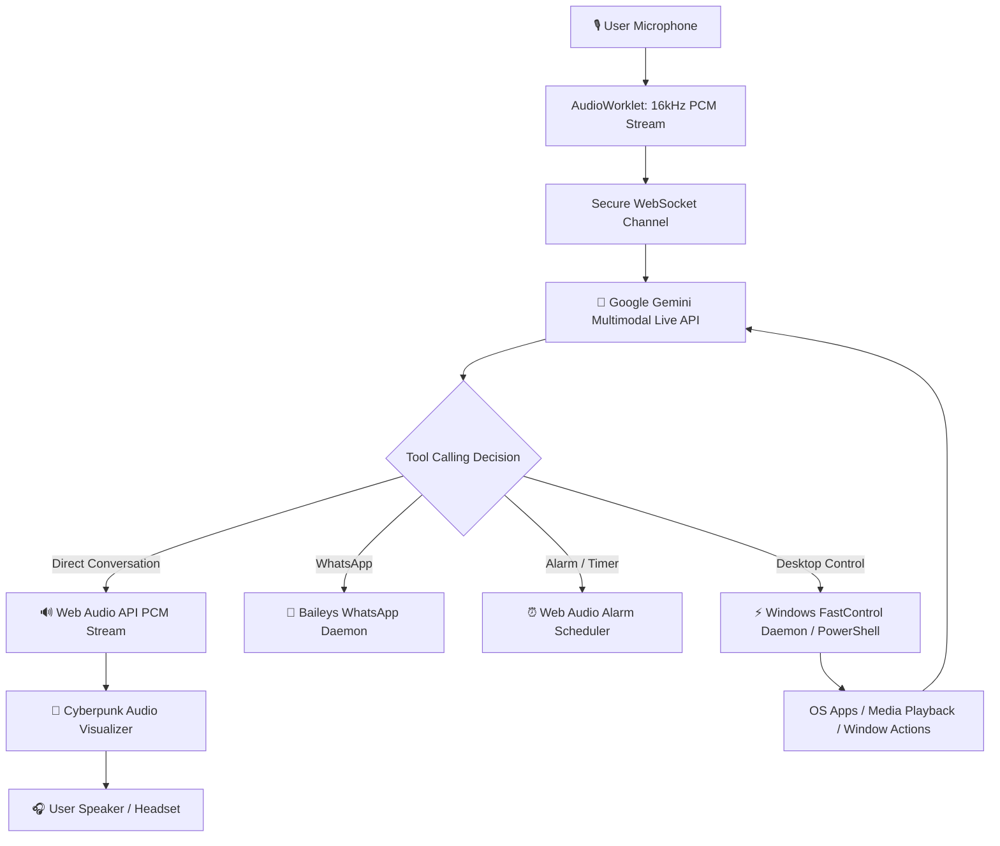

<p align="center">
  
</p>

<h1 align="center">🌸 ZOYA AI ASSISTANCE</h1>

<p align="center">
  <strong>The Next-Generation Real-Time Multimodal Voice AI & Autonomous Desktop Companion</strong><br>
  <em>Powered by Google Gemini Multimodal Live API • Real-Time Voice-to-Voice • Acoustic Empathy • WhatsApp Baileys • Windows OS Automation</em>
</p>

<p align="center">
  <a href="https://github.com/oii-siba/zoya-Ai-Assitance/stargazers"></a>
  <a href="https://github.com/oii-siba/zoya-Ai-Assitance/network/members"></a>
  <a href="https://github.com/oii-siba/zoya-Ai-Assitance/blob/main/LICENSE"></a>
  <a href="https://ai.google.dev/"></a>
</p>

<p align="center">
  
  
  
  
  
  
</p>

---

## 🌟 Overview

**Zoya AI Assistance** is not just another chatbot—it is an ultra-low-latency, full-duplex, multimodal AI companion that talks, listens, empathizes, and controls your operating system hands-free.

Built on Google's breakthrough **Gemini Multimodal Live WebSocket API**, Zoya processes raw bidirectional audio in real time. She speaks fluent Bengali (বাংলা), English, and Hindi, understands human emotion from vocal acoustics, handles background WhatsApp messaging, automates Windows applications, and manages smart wake-up alarms—all with a sweet, lively, and intelligent personality.

> 💬 *"Hello! আমি জয়া, আপনার পার্সোনাল ভয়েস এআই অ্যাসিস্ট্যান্ট। বলুন, আজ আপনাকে কীভাবে সাহায্য করতে পারি?"*

---

## 🚀 Key Innovations & Superpowers

| Feature | Description |
|---|---|
| 🎙️ **Full-Duplex Live Voice** | Direct bidirectional Web Audio streaming via WebSocket. Zero text intermediate delay—talk naturally and interrupt whenever you want! |
| 💖 **Acoustic Emotion Intelligence** | Proprietary emotion engine perceives vocal tone (Happy, Sad, Stressed, Whisper, Calm) and immediately adapts response empathy and volume. |
| 👤 **Dynamic Identity & Name Customization** | Set your own name and title (*Boss, Bhaiya, Sir, Buddy*) directly from Settings. Zoya remembers and greets you personally! |
| 📱 **Background WhatsApp (Baileys)** | Send WhatsApp messages and announce incoming notifications hands-free via mobile-connected Baileys engine without opening windows. |
| 💻 **Complete Windows Desktop Automation** | Launch software (VS Code, Chrome, Notepad, Calculator), search & play YouTube songs, scroll web pages, manage system volume, sleep, and shutdown. |
| ⏰ **Smart Spoken Alarms** | Voice-scheduled reminders and wake-up calls with spoken Bengali announcements and snooze/dismiss controls. |
| 🤫 **Intelligent Standby ("চুপ মোড")** | Tell Zoya *"চুপ করো"* and she goes completely silent while you talk to friends or take phone calls. Resume instantly with *"জয়া বলো"*. |
| 🌊 **Futuristic Cyberpunk Visualizer** | Real-time particle waveform with multiple visual themes: *Neon Quantum, Cyberpunk Violet, Matrix Green, Hologram Blue, Retro HUD*. |
| 🔒 **StarGate™ Community Lock** | Open-source safeguard ensuring every user stars the repository to support the creator before first launch. |

---

## 🎭 Voice Personas

Choose between 6 handcrafted persona models to match your conversational vibe:

| Persona | Archetype | Tone & Behavioral Style |
|:---:|:---:|---|
| 👧 **Cute Zoya** *(Default)* | Cute Little Sister | Sweet, cheerful, affectionate, and protective assistant |
| 💖 **Sweet Female** | Warm Companion | Soft, gentle, calming voice with high emotional empathy |
| 👶 **Kid Voice** | Playful Kid Helper | Innocent, energetic, enthusiastic helper voice |
| 👩‍💼 **Prof. Female** | Executive Assistant | Sharp, professional, articulate, and direct |
| 💅 **Sassy BFF** | Witty Best Friend | Playful, humorous, sarcastic wit and modern banter |
| 🤖 **Cyber Butler** | JARVIS / Sci-Fi Butler | Sophisticated, formal, robotic-futuristic efficiency |

---

## 🏗️ Architecture & How It Works



---

## ⚡ Quick Start & Installation

Getting Zoya running on your machine takes less than **2 minutes**!

### 🌟 Method A: One-Click Launcher (Windows - Recommended)

1. Clone or download this repository.
2. In the project folder, simply **double-click `start.bat`**.
3. That's it! `start.bat` will:
   - Check if Node.js is installed
   - Auto-install all project dependencies (`npm install`)
   - Create local `.env` configuration file
   - Launch the development server automatically!

---

### 💻 Method B: Terminal Setup (Mac, Linux & Windows)

```bash
# 1. Clone the repository
git clone https://github.com/oii-siba/zoya-Ai-Assitance.git
cd zoya-Ai-Assitance

# 2. Install dependencies
npm install

# 3. Launch development server
npm run dev
```

> ⭐ **Star Verification**: On the first launch, Zoya will verify that you have given a Star to our repository. Enter your GitHub username when prompted to unlock your session!

Visit **`http://localhost:5173`** in your browser.

---

## ⚙️ Initial Setup & Configuration

Once the web interface opens:

1. **Allow Microphone Access**: Click **Allow** when the browser asks for mic permissions.
2. **Open Settings (⚙️)**:
   - **User Identity**: Enter your name (e.g. `Rahul`) and title (e.g. `Boss`, `Bhaiya`, `Sir`).
   - **Gemini API Key**: Paste your free API key from [Google AI Studio](https://aistudio.google.com/).
   - **Voice Persona**: Select your favorite voice persona.
3. Click **Save & Connect**—Zoya is now awake and listening!

---

## 🗣️ Voice Commands Cheat Sheet

Speak naturally to Zoya in **Bengali, English, or Hindi**! Here are some fun examples:

### 🎵 Entertainment & Media
- *"Zoya, ekta Arijit Singh er gaan chalao"* (Searches and plays top song on YouTube)
- *"Zoya, porer gaan ta dao"* (Skips to the next video)
- *"Gaan ta pause koro"* / *"Abar play koro"* (Pauses / resumes YouTube playback)

### 📱 WhatsApp Messaging
- *"Zoya, amader friend Sourav ke WhatsApp-e 'kothay tui?' bole message pathao"*
- *"Sourav ke 3 bar 'urgent call me' pathao"* (Repeats message 3 times)

### ⏰ Alarms & Wake-up Calls
- *"Zoya, amake shokal 7:00 tay deke dio"*
- *"Amake 15 minute por dakbe"*

### 💻 OS & Laptop Control
- *"Calculator open koro"* / *"Chrome chalu koro"* / *"VS Code kholo"*
- *"Volume 80% koro"* / *"Volume mute koro"*
- *"Page ta niche scroll koro"*
- *"Laptop ta sleep mode-e dao"* / *"PC shutdown koro"*

### 🤫 Privacy & Standby Mode
- *"Zoya, ektu chup koro"* (Zoya enters silent standby mode)
- *"Zoya bolo"* (Zoya resumes active conversation)

---

## 📁 Repository Directory Structure

```text
zoya-ai-assistance/
├── public/                 # Static branding, avatars & sound effects
├── scripts/
│   ├── check-star.mjs      # Terminal pre-dev StarGate verification
│   ├── whatsapp_baileys.mjs # Background WhatsApp headless client
│   ├── desktop_automation.ps1 # Windows OS automation engine
│   └── ZoyaFastControl.cs  # High-performance C# Win32 automation daemon
├── src/
│   ├── components/
│   │   ├── SettingsOverlay.tsx # Identity, voice, and API settings modal
│   │   ├── StarGate.tsx        # In-browser GitHub star verification lock
│   │   └── Waveform.tsx        # High-FPS canvas particle audio visualizer
│   ├── services/
│   │   ├── LiveSession.ts      # WebSocket manager for Gemini Multimodal Live API
│   │   ├── EmotionDetector.ts  # Acoustic vocal emotion analysis engine
│   │   ├── VoiceBiometrics.ts  # Speaker identification & voice lock
│   │   └── AlarmScheduler.ts   # Persistent spoken alarm scheduler
│   ├── utils/
│   │   └── personality.ts      # Dynamic user identity prompt adapter
│   ├── App.tsx                 # Main application UI orchestrator
│   └── main.tsx                # React DOM entrypoint
├── start.bat               # 1-Click Windows launcher & auto-installer
├── package.json            # Project dependencies & scripts
└── vite.config.ts          # Vite configuration & backend proxy tools
```

---

## 🔒 Security & Privacy First

- 🛡️ **Zero Secret Leaks**: All personal API keys, passwords, and tokens are stored solely in your local browser's encrypted `localStorage` or `.env` file.
- 🛡️ **Safe WhatsApp Storage**: WhatsApp connection sessions in `whatsapp_auth/` are strictly ignored by `.gitignore`.
- 🛡️ **No Private Passcodes**: Fully open-source and customizable without any hardcoded credentials.

---

## 🤝 Contributing

Contributions make the open-source community an amazing place to learn, inspire, and create! Any contributions you make are **greatly appreciated**.

1. Fork the Project
2. Create your Feature Branch (`git checkout -b feature/AmazingFeature`)
3. Commit your Changes (`git commit -m 'Add some AmazingFeature'`)
4. Push to the Branch (`git push origin feature/AmazingFeature`)
5. Open a Pull Request

---

## 🌟 Show Your Support

If you like **Zoya AI Assistance**, please give this repository a **Star ⭐**! It motivates continuous development and helps more developers discover the power of real-time voice AI.

<p align="center">
  <a href="https://github.com/oii-siba/zoya-Ai-Assitance">
    
  </a>
</p>

---

## 📄 License

Distributed under the **MIT License**. See [`LICENSE`](LICENSE) for more information.

---

<p align="center">
  Made with 💖 by <strong><a href="https://github.com/oii-siba">Siba</a></strong>
</p>
